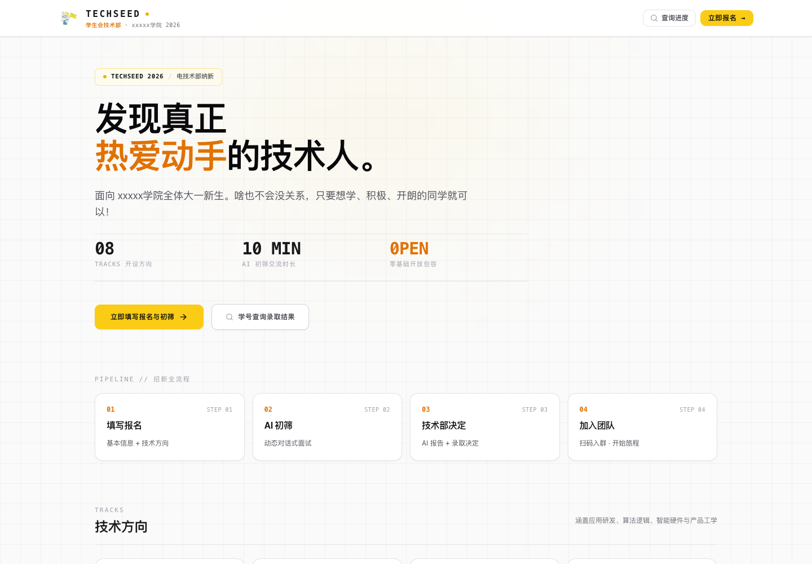
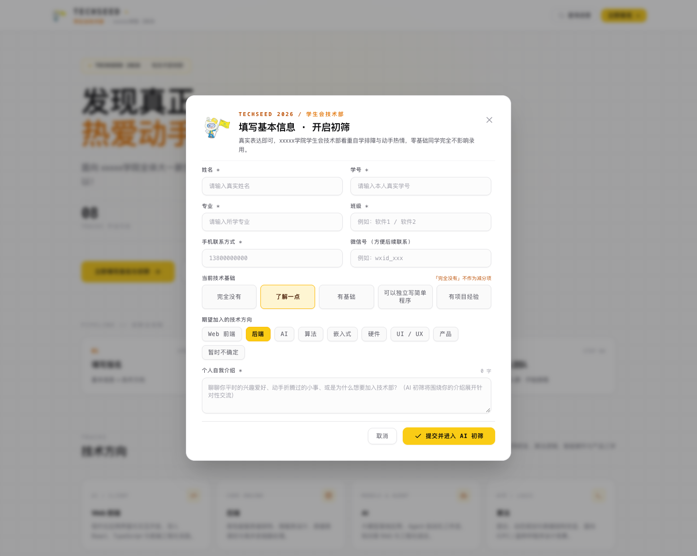
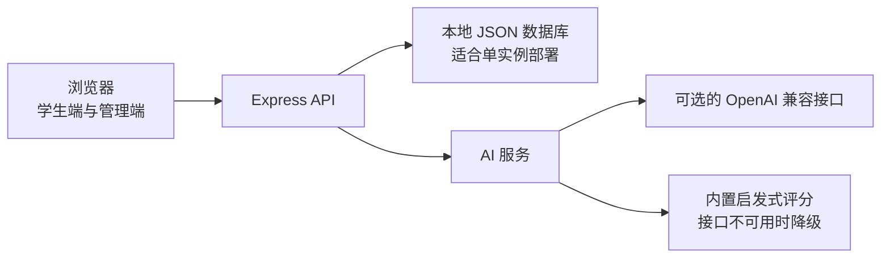

# TECHSEED AI 招新系统

[](https://github.com/Ibook000/TECHSEED/actions/workflows/ci.yml)

xxxxx学院学生会技术部 AI 招新系统（Tech Dept AI Recruitment System）。

单页应用实现完整招新流水线：学生注册 → AI 面试 → 智能评估 → 管理端审核 → 微信群准入。

## 页面预览

### 招新首页



### 报名与 AI 初筛



## 功能特性

- **学生端**：报名后安全保存访问凭据、AI 多轮面试（断点续答）、找回个人进度、入群二维码展示与入群确认
- **管理端**：批次管理、候选人列表与详情、AI 评估报告、人工面试流转、状态流转审计、CSV 导出、数据看板（雷达图/柱状图/饼图）
- **AI 能力**：面试题目生成 + 最终评估，支持任意 OpenAI 兼容接口（DeepSeek、Qwen、Ollama 等），多 Key 负载均衡与降级备用池；LLM 不可用时自动切换内置启发式评分引擎
- **安全**：管理端 HMAC-SHA256 签名 Token、scrypt 密码哈希、学生独立访问凭据、候选人接口鉴权、公开接口限流与输入长度限制

## 技术栈

| 层 | 技术 |
| --- | --- |
| 前端 | React 19 + TypeScript + Vite + TailwindCSS v4 + lucide-react + recharts |
| 后端 | Node.js + Express（API 与 SPA 同进程） |
| 数据库 | JSON 文件数据库（`data/db.json`，无外部依赖） |
| AI | OpenAI 兼容 Chat Completions 接口 + 启发式评分引擎 |

## 架构概览



应用默认使用单进程和本地 JSON 文件保存数据。多实例部署或高并发招生前，应先迁移到 SQLite 或托管数据库，并配置共享限流与备份。

## 快速开始

### 环境要求

- Node.js 22.12+（建议使用仍在维护期的 LTS 版本）
- npm（本项目的包管理器）

### 安装与启动

```bash
# 1. 按 lockfile 安装依赖
npm ci

# 2. 配置环境变量；新数据库初始化前必须在 .env 中设置 ADMIN_DEFAULT_PASSWORD
copy .env.example .env

# 3. 启动开发服务器（Express 进程内挂载 Vite 中间件，端口 3000）
npm run dev
```

首次启动会自动生成 `data/db.json` 种子数据：默认批次、管理员账号（用户名 `admin`）、默认 AI 提示词等。创建新数据库前，必须在 `.env` 中设置唯一且足够强的 `ADMIN_DEFAULT_PASSWORD`；源码不再包含通用初始密码。

### 常用命令

```bash
npm run dev     # 开发模式（tsx server.ts，端口 3000）
npm run build   # 构建产物：vite build + esbuild 打包 server.ts -> dist/server.cjs
npm run start   # 运行构建产物 node dist/server.cjs
npm run lint    # TypeScript 类型检查（tsc --noEmit）
npm run audit   # 检查已知依赖漏洞（npm audit）
npm run clean   # 清理构建产物
```

推送到 `main` 或提交 Pull Request 时，GitHub Actions 会在 Node.js 22 和 24 上执行依赖审计、类型检查与生产构建。

## 参与贡献

欢迎提交问题反馈和 Pull Request。首次贡献请先阅读[贡献指南](CONTRIBUTING.md)；安全问题请参考[安全政策](SECURITY.md)。

## 环境变量

复制 `.env.example` 为 `.env` 后按需修改：

| 变量 | 说明 |
| --- | --- |
| `PORT` | 服务端口，默认 3000 |
| `TRUST_PROXY_HOPS` | 可信反向代理层数，直连部署保持 `0`；仅按实际可信代理链路配置 |
| `OPENAI_API_KEY` / `OPENAI_API_KEYS` | 主 LLM 池 Key，`_KEYS` 支持逗号分隔多 Key |
| `OPENAI_BASE_URL` / `OPENAI_MODEL` | 主 LLM 接口地址与模型名 |
| `FALLBACK_OPENAI_*` | 降级备用池（主池全部失败时启用），变量含义同上 |
| `LLM_MAX_CONCURRENT` | LLM 请求并发上限，默认 10；最多 100 个等待请求，排队超过 30 秒会降级到启发式引擎 |
| `ADMIN_DEFAULT_PASSWORD` | 初始化新数据库前必填的管理员初始密码（12–128 个字符）；没有内置默认值 |
| `AUTH_TOKEN_SECRET` | 管理端 Token 签名密钥，留空自动生成并持久化 |
| `DISABLE_HMR` | 设为 `true` 禁用 HMR 与文件监听（生产部署用） |

> 数据库中的 `ai_settings` 优先级高于环境变量，管理端"AI 设置"界面修改后立即生效，无需重启。

## 使用指南

### 学生端

1. 访问首页 `http://localhost:3000/`，填写报名表完成报名
2. 进入 AI 面试，逐题作答（本设备自动保存会话；换设备可凭报名时的学号、姓名和手机号找回）
3. 面试完成后等待 AI 评估与管理端审核
4. 审核通过后页面展示微信群二维码，确认入群完成流程

学生访问 `/status` 查询进度。本设备保存随机访问凭据；换设备时需要填写报名时的学号、姓名和手机号。服务器只保存访问凭据的 SHA-256 摘要，找回成功后会轮换凭据并使旧凭据失效。

### 管理端

1. 访问 `http://localhost:3000/admin`（应用内任意页面按 `Ctrl+Shift+A` 可快速跳转）
2. 使用管理员账号登录（用户名 `admin`，密码为 `.env` 中配置的 `ADMIN_DEFAULT_PASSWORD`）
3. 可执行：批次管理、候选人审核、状态流转、人工面试安排、AI 提示词与 AI 设置维护、CSV 导出

### 候选人状态流转

```
REGISTERED → AI_INTERVIEWING → AI_COMPLETED → AI_RECOMMENDED / AI_NOT_RECOMMENDED
  → WAITING_MANUAL_INTERVIEW → MANUAL_INTERVIEWING
  → MANUAL_PASSED → QR_AVAILABLE → GROUP_JOIN_PENDING → GROUP_JOIN_CONFIRMED → ADMITTED
```

离线/终止状态：`MANUAL_REJECTED`（淘汰）、`MANUAL_WAITLIST`（候补）。

### 评估维度与权重

启发式引擎与 AI 提示词共用同一套权重：

- learning 25% · initiative 20% · logic 20% · technology_interest 15% · communication 10% · technical_foundation 10%
- 评级：S ≥ 90，A ≥ 80，B ≥ 70，C < 70

## 项目结构

```
server.ts               # Express 入口：全部 API 路由 + Vite 中间件（开发）/ 静态托管（生产）
server/
  db/index.ts           # JSON 文件数据库（data/db.json），首次启动自动播种
  services/
    recruitment.ts      # 业务逻辑：报名、面试流转、状态机、准入/淘汰、评分
    ai.ts               # LLM 集成层：题目生成、评估、多 Key 池、降级策略、启发式引擎
src/                    # React 19 前端（单页，无路由库，按路径手动切换视图）
  types.ts              # 共享类型定义（含 15 个候选人状态枚举）
public/                 # 静态资源
data/                   # 运行时数据库（不入版本控制，首次启动自动生成）
```

## 部署说明

### Docker Compose

需要安装 Docker Compose。首次启动前，复制并编辑环境变量文件，至少设置一个唯一且足够强的管理员初始密码：

```bash
cp .env.example .env
# 编辑 .env，设置 ADMIN_DEFAULT_PASSWORD；按需配置 AI 服务
docker compose up -d --build
```

服务默认只绑定到本机 `127.0.0.1:3000`，可以通过本机反向代理接入，并在代理层启用 HTTPS。首次创建的数据库保存在 `techseed-data` 命名卷中；容器重建不会删除数据。查看运行状态和日志：

```bash
docker compose ps
docker compose logs -f app
```

停止服务时使用 `docker compose down`。删除命名卷会永久删除招新数据；日常升级不要附加 `-v` 参数。

### PM2

生产环境使用 PM2 托管（参考 `ecosystem.config.cjs`）：

```bash
npm run build
pm2 reload ecosystem.config.cjs --update-env
```

注意事项：

- 生产环境通过 `.env` 提供配置（PM2 仅注入 `NODE_ENV` 与 `PORT`，其余由 dotenv 从进程工作目录读取）
- `data/db.json` 为唯一持久化层，**停止进程后再备份或替换该文件**（数据库为内存单例，运行中替换会被旧状态覆写）
- 数据库写入采用临时文件替换；若现有文件无法解析，服务会停止启动并保留原文件，避免自动重置覆盖报名数据
- 管理端 Token 签名密钥持久化在数据库中，PM2 内存重启后登录态仍然有效

## 安全说明

- `data/db.json` 含真实学生记录、密码哈希与 AI Key 副本，**已加入 `.gitignore`，严禁提交或上传**
- 管理端密码为 scrypt 哈希存储，新设密码要求 12–128 个字符；历史明文条目在首次成功登录时自动升级。修改密码会撤销其他旧登录会话，并为当前会话换发 Token
- 学生的候选人档案、面试、入群确认和二维码接口均校验随机访问凭据；找回使用学号、姓名和报名手机号并受限流保护。此流程没有短信验证码，属于多项报名信息校验，不等同于短信或学校统一身份认证
- 报名表会说明个人信息和 AI 面试问答的用途及外部模型处理情况；服务端保存确认版本与时间。文案变更时应更新 `REGISTRATION_CONSENT_VERSION`
- 当前限流状态保存在单个服务进程内存中。若部署多个应用实例，应改用共享限流存储；通过反向代理部署时，按实际可信代理层数配置 `TRUST_PROXY_HOPS`
- 正式存放真实候选人资料前，应使用 HTTPS，并考虑接入短信验证码或学校统一身份认证
- CSV 导出通过 `Authorization` 请求头携带 Token，Token 不出现在 URL 中

## 验证

本地可运行类型检查和生产构建：

```bash
npm run lint
npm run audit
npm run build
```

当前项目尚未建立自动化单元测试。招新核心流程、数据迁移与权限边界仍需要补齐独立测试后，再考虑面向真实报名数据的生产部署。
